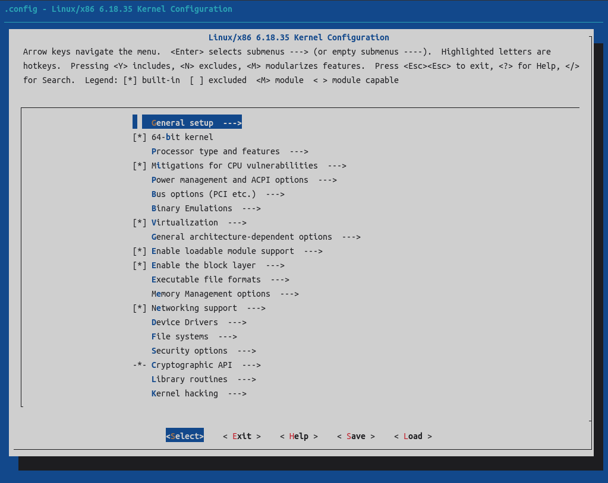
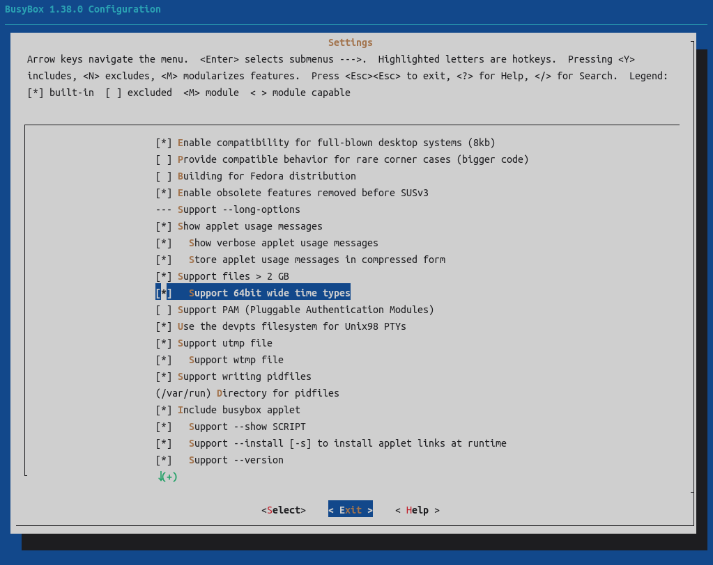

# Make构建系统的使用方法

为了简化软件的构建，人们开发了许多构建系统来简化软件构建过程。而对于使用C和C++开发的项目来说make是最常见的通用构建系统<!-- 为make、cmake和Meson -->之一。下文将说明使用make构建系统构建软件的通用构建和安装步骤。

make是Linux世界的基础设施最常用的构建系统。make的构建过程通常分为四个步骤，即：安装编译依赖、配置构建参数、编译、安装。

## 安装编译依赖
安装编译依赖实际上与使用的编译系统无关但他们通常都分为两部分：一 安装编译工具、二 安装依赖。安装的编译工具包括编译器及构建工具，他们由构建项目的具体需要而决定。编译时所需的依赖也取决于构建的对象的具体需要。通常在软件的源码包或开发文档中说明其所需安装的编译工具及依赖。

## 配置构建参数

一个项目通常允许使用一些参数来控制其编译过程，也许我们并不需要设置构建参数但都需要运行配置脚本，因为这些脚本还用于检查系统构建环境并生成最终的编译脚本及编译配置。

### configure
对于使用make构建的项目来说，最常用的的构建参数配置器是configure脚本。该脚本由各项目自己提供，其对应的执行命令为`./configure [OPTIONS ...]`，OPTIONS即为构建参数。对于使用configure来配置构建参数的软件来说，configure脚本通常会提供几条约定俗成的构建参数。如`--prefix=/path/to/install_dir`，`--prefix`参数用于指定编译完毕后的安装时的安装目录。除了少量的通常共有的构建参数外还有许多参数是独有的，他们取决于项目本身，如需了解这些configure脚本的构建参数通常可以通过命令`./configure --help`查看或查看项目开发文档中有关部分来了解。在此专门强调一下，configure脚本虽然被广泛使用，但没有什么规范强制要求configure脚本必须提供那几条构建参数。换句话说，configure脚本所提供的所有参数都是由项目开发团队提供，有哪些参数他们可以自由决定。如果他们乐意，他们可以把`--prefix`参数和`--help`参数改个名，甚至压根不提供这些参数。之所以`--help`、`--prefix`这类参数这么常见，也只是开发团队采用了这些“习惯”而已。使用configure脚本作为构建参数配置器的项目除了（可能会）提供`--prefix`、`--help`等参数外还可能会提供用于设置项目源代码文件路径的参数和指定编译命令及链接命令的参数，如：`CC=...`, `CXX=...`, `CFLAGS=...`, `CXXFLAGS=...`, `LDFLAGS=...`等等等等。

### Kbuild
Kbuild也是一个相对常见的构建参数配置器，其原本是为了构建Linux内核而制造出来的，后来被一些项目也采用了Kbuild作为其构建参数配置器，诸如Linux、busybox、openwrt等项目使用了Kbuild作为其构建参数配置器。通过`make config`或`make menuconfig`注1命令即可执行Kbuild的构建参数配置器。
<!-- 此段的表述实际上存在错误但我不清楚应如何正确表述，严格来说Kbuild实际上是一个高级构建系统 -->

config是一个CLI形式的配置器，使用config时需要对所有配置项进行逐项配置。直接回车表示使用默认配置，默认配置将会大写标出或通过`>`符号标出，键入`?`并回车即可查看当前配置项的说明。关于config配置器其实还有一些东西要说明，但不说明其实也看得出来。除此之外还有一些项目特定的东西，这些也没必要解释。所以关于config就介绍到这里，下面介绍交互更加人性化的menuconfig。

menuconfig是一个类TUI形式的配置器，其提供了一套易于交互的界面。  

  
  

在meunconfig中可以使用上下键移动当前选中的配置项，左右键则可以在不同的底部选项间移动。配置项前面的`[]`表示一个二元的配置项，其中为空表示不编译，为`*`表示编译。选中配置项后使用`Y`键则将其勾选，`N`键则取消勾选，还可以使用空格键改变当前勾选状态。如果配置项的前面为`()`，则其为字符串型配置项，选中后回车即可编辑配置项的字符串内容，`TAB`键可用于在输入框和各选项之间切换焦点，编辑完毕后选中`<Ok>`并回车即可完成编辑。若一个配置项前的状态标识为`-*-`或`---`则表示当前无法改变此配置项的状态（可能因为别的配置项依赖于此配置项当前的状态，在此类情形中需改变依赖此项的配置项的状态解除依赖后才可以更改此类项的勾选状态）。末尾有`--->`的配置项含有子菜单，可在选中此类配置项后回车进入其子菜单。`ESC`键的功能为返回上一级（如：从子菜单返回、不保存退出字符串编辑）。部分项目将menuconfig中配置的Save与Load设置为菜单底部的选项，还有部分项目将Save和Load设置成主菜单中的伪配置项<!-- 这是自创的说法 -->，有的项目可能还会在主菜单单击`ESC`时保存配置。总之配置的保存与加载方法是由项目自己定义的，不同的项目可能会有保存和加载的方法。  

注：在一些项目的meunconfig中还可能会存在其他配置项类型标识以及其他的配置项勾选状态。用户可根据项目文档的说明和menuconfig顶部提示信息了解这些配置项类型和勾选状态的含义。

注1：除了config和menuconfig配置器外Kbuild实际上还提供了nconfig、xconfig等类似menuconfig的图形化配置器，但在其他使用了Kbuild的项目中鲜有启用这些配置器，故不作说明。<!-- 此注解是故意放在Kbuild说明的末尾的 -->

### 特殊情况说明
除此之外，部分微小型项目没有专门的“配置构建参数”步骤，这类软件可能可以在编译过程指定一些构建参数，也可能根本就没有“构建参数”一说。

<!-- 示例123 -->

## 编译
在配置构建参数步骤完毕后执行命令`make`即可编译软件，部分项目可能会提供多种编译选项，如Linux内核可以使用`make bzImage`命令来仅编译内核，而不编译内核模块，至于一个项目提供哪些编译选项则可通过查阅项目的编译说明文档了解或使用`make help`命令查看（make的help目标是由待编译的对象的开发团队提供的，所以也有可能不提供）。在使用make命令编译软件时可以添加参数`-jN`用于指定编译时可用的线程数（参数内的N要替换为想要使用的线程数，其取值范围通常为`[1, CPU线程总数]`）。若想使用所有CPU线程进行编译可以使用参数`-j$(nproc)`（`nproc`命令用于获取CPU的线程数）。

<!-- 示例123 -->

## 安装
软件编译完成后通常使用`make install`注2命令来安装软件。如果把软件软件安装在一个临时安装目录（即非最终的安装目标路径）用于后续打包软件或执行其他操作，则可以添加参数`DESTDIR=tmp_install_dir`注3来将软件安装到指定的临时安装目录。有的项目还支持其他make安装子命令（目标），如GCC可以通过`make strip_install`命令来安装剥离了调试符号的GCC。至于有哪些安装命令，可查阅项目的编译安装相关文档来了解或使用`make help`命令查看（如果有的话<!-- 该表意模糊的表述是有意而为，是有无help目标？help目标中有无提及安装相关命令的说明 -->）。

注2：是否提供install目标或用于安装软件的目标名是否叫install也取决于待安装对象本身。

注3：该参数是否提供也是由待安装的对象决定的，但该参数是《GUN编程标准》（*GNU Coding Standards*）建议提供的一个参数，所以大部分使用make作为构建系统的软件都支持该参数。

<!-- 示例123 -->

## 清理
`make clean`命令可用于清理构建时产生的所有文件。`make distclean`命令用于清理配置时和构建时产生的所有文件（如：编译配置文件）。通常使用make作为构建系统的项目都会提供`clean`和`distclean`目标，但这并仍非强制性的注。一个项目的清理功能可能会通过其他名字的目标实现或通过其他方法实现。

注：虽然不是强制性要求提供`clean`和`distclean`，但*GNU Coding Standards*中建议项目提供这两个目标。

## 参考资料
[GNU Make Manual](https://www.gnu.org/software/make/manual/make.pdf)  
[menuconfig配置界面和kconfig语法 - 知乎](https://zhuanlan.zhihu.com/p/1966786053395420793)  
Linux make help  
[Kernel Build System - The Linux Kernel  documentation](https://www.kernel.org/doc/html/latest/kbuild/index.html)  
[GNU Coding Standards](https://www.gnu.org/prep/standards/standards.pdf) Section 7.2.4 DESTDIR: Support for Staged Installs

---
Author: smgdream | License: CC BY-NC-SA 4.0 | Version: 0.3.6 | Date: 2026-09-23