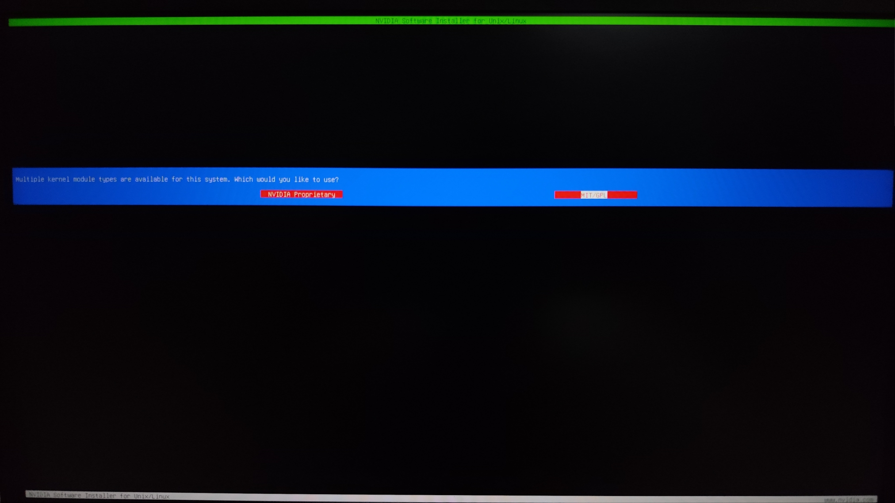
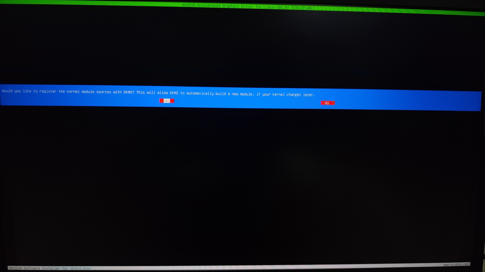
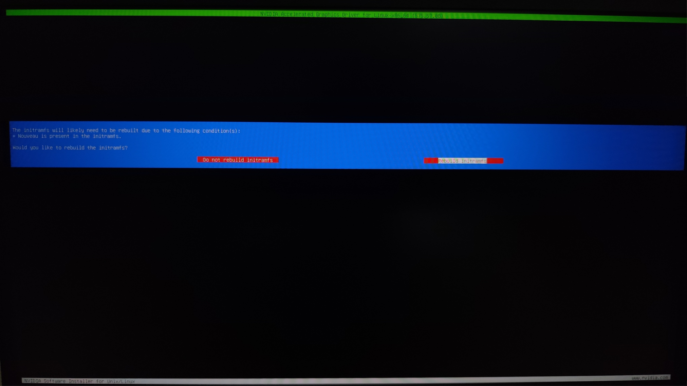
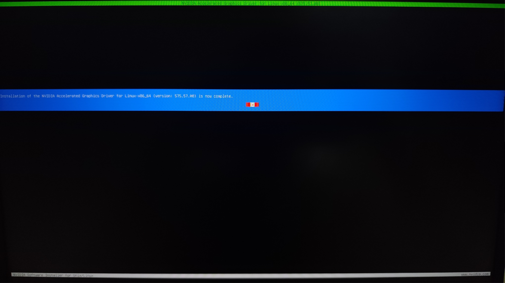

# Deal late no more NVIDIA <!-- 正式标题：NVIDIA驱动的安装与配置，英文非正式标题：HOW TO FUCK NVIDIA -->

  
此时无声胜有声  

现在，这个名场面已经过去10年了，nvidia对linux的支持也好了很多，而且现在nvidia也把内核模块驱动开源了。而对于Debian来说nvidia的独显驱动的支持也相当不错了。但nvidia仍是三家中最封闭的显卡公司，毕竟开源驱动都是逆向出来的，目前也只能当亮机驱动用，所以说“经典永不过时”。下面分别说明安装官方驱动的方法和通过apt安装nvidia驱动的方法（注意：nvidia驱动的安装比较特殊，建议看完对应安装方法后再进行驱动的安装）。  

**特别说明：** 以下安装方法假设你已经禁用计算机的安全启动，如果未禁用可参照[安装Debian](../start/install-deb.md)中“关闭安全启动和TPM”的方法关闭安全启动。如果你实在不肯关闭安全启动，驱动的安装过程将多出一些额外步骤，本文不会提及这部分内容，具体安装方法请自行上网查阅。  

下文提供了3种驱动安装方法：第一种安装方法安装NVIDIA官方提供的run驱动，其具有最完善的NVIDIA显卡支持，但安装步骤稍显繁琐且对用户的Linux水平有一定要求。第二种安装方式通过NVIDIA官方提供的CUDA源安装显卡驱动，最简单快捷适合于新手以及有CUDA使用需求的用户。第三种安装方式安装Debian官方提供的NVIDIA显卡驱动，理论上来说对Debian的适配最为完善（但实则不然），且驱动较旧不支持50系显卡（笔者不推荐使用该安装方法）。

## 安装官方run驱动

安装官方驱动可以及时支持新的显卡以及体验新的图形特性。Debian Wiki不建议用户安装nvidia的官方驱动说是可能会存在兼容性问题。但依据我的实际经验来看安装官方驱动是基本没问题的，笔者使用的就是官方驱动（我遇到的唯一一次问题是有一次内核小版本更新后驱动在新内核上编译出错，回到老内核就可以了。而且很快就有大佬提供了解决方案（要改几行代码），然后没过多久nvidia也发布了小版本驱动更新，在新驱动在新内核上就没有安装编译报错了）。官方nvidia驱动的安装方式如下：  

从[NVIDIA驱动下载页面](https://www.nvidia.com/en-us/drivers/)选择适用于当前机器显卡的较新<sup>注1</sup>驱动并下载。然后登出图形界面并停止显示管理器（如：对于使用gdm3作为显示管理器的用户，可通过`systemctl stop gdm3`命令结束显示管理器）。之后执行以下命令安装依赖工具、依赖文件、依赖库和DKMS框架（DKMS框架用于在内核更新时自动构建新的驱动模块）。  
```sh
apt install build-essential linux-headers-$(dpkg --print-architecture) pkg-config libglvnd-dev dkms
```
说明：`dpkg --print-architecture`命令可用于获取合适格式的当前机器的架构名。  

安装32位NVIDIA兼容库：如果需要在安装驱动时安装32位NVIDIA库需要在启动安装驱动前需要通过以下命令添加i386架构支持并安装相应基础依赖库。
```sh
dpkg --add-architecture i386
apt install libc6:i386
```

然后通过`chmod +x <NVIDIA_DRIVER_RUNFILE>`命令授予驱动安装包可执行权限并执行（如：`chmod +x ./NVIDIA-Linux-x86_64-575.57.08.run`）。之后可能会显示是否同意用户协议，同意即可。然后可能会询问要安装的内核模块驱动类型。  
  
Turing及更新架构（20系以及之后的显卡）选择“MIT/GPL”（开源内核驱动），Turing之前的架构（20系之前的显卡）选择“NVIDIA Proprietary”（专有内核驱动）（以上规则已经笔者简化，关于不同内核模块选择的详细信息见：[Driver types - NvidiaGraphicsDrivers - Debian Wiki](https://wiki.debian.org/NvidiaGraphicsDrivers#Driver_types)）。  

然后将会开始安装过程，中途可能会询问是否安装32位库，如果不清楚或没有这类需求则不用安装。后面可能还会询问是否启用DKMS通常选择"Yes"。  
  
最后一步驱动安装程序可能会询问是否要重新构建initramfs，选择重新构建并稍后即可完成安装。  
  
  
最后重启计算机即可使用nvidia驱动。  

额外说明：在安装过程中可能会出现一个Error说：“当前系统在使用Nouveau”，此时请勿惊慌"OK"继续，下一步将会询问是否禁用Nouveau选择"Yes"即可，后面还可能会询问是否重建initramfs选择"Yes"即可，在后面的界面中通常选择重启计算机然后重新关闭gdm3并重新进入驱动安装程序。在安装的途中可能还会出现一些莫名其妙的窗口如果不清楚选择默认选项即可。  

**注意：** 主版本为580的驱动是最后一版支持Maxwell、Pascal和Volta架构的驱动（大概就是GTX10系列及之前的系列和Titan V及之前的Titan显卡）。  

注1：下载较新驱动的意思是：在较新的驱动中找一个运行起来无论是玩游戏或是剪辑、建模、渲染都没有问题的驱动（其实Debian提供的驱动也可能会有问题，可能反倒官方驱动没问题），但具体哪个驱动合适，我只能说：“实践是检验真理的唯一标准”。  

注：可在 https://download.nvidia.com/XFree86/ 获取适用于（类）UNIX操作系统的各版本NVIDIA显卡驱动的存档

### run驱动更新
更新run文件版的NVIDIA显卡驱动建议<sup>注2</sup>先卸载当前驱动（通过`nvidia-uninstall`命令），再重启计算机安装新驱动<sup>注3</sup>。  

注2: 其实正常情况下直接安装run驱动即可更新驱动，但经过笔者长期的使用发现直接安装run文件更新驱动有一定概率驱动更新失败。所以建议先卸载再安装。 

注3: 无论是首次安装run驱动还是更新run驱动，在安装驱动前要记得结束显示管理器。

## 通过NVIDIA CUDA源安装驱动
NVIDIA的CUDA工具中包含了NVIDIA显卡驱动，且CUDA工具包中的驱动与库为多个Linux发行版提供了专门官方的构建，其中包括了为Debian提供的deb包。CUDA工具包中的驱动可以单独安装，不必为了安装驱动而去安装完整的CUDA工具包。

NVIDIA提供了源仓库形式的CUDA工具包，通过将该源添加至APT源配置文件中后即可通过包管理器安装NVIDIA驱动（通过包管理器安装驱动不会和使用run文件安装驱动那么复杂，而且其还能自动配置wayland相关支持，亦能通过`apt upgrade`命令一键更新）。不过笔者使用CUDA源NVIDIA驱动时发现（相对于run文件版驱动）NVIDIA 显卡控制面板部分菜单少了一些信息显示和选项，笔者不清楚这是显卡控制面板的问题还是驱动的问题（亦不清楚其有无暗示部分显卡功能无法使用），但经过笔者的测试NVIDIA显卡基本的图形加速功能是没问题的。下面笔者将说明如何添加CUDA源并安装CUDA源中的显卡驱动。  
<!-- todo check: https://docs.nvidia.com/datacenter/tesla/pdf/Driver_Installation_Guide.pdf -->


首先通过以下命令添加CUDA源并更新软件包列表。  
```sh
wget https://developer.download.nvidia.com/compute/cuda/repos/debian13/x86_64/cuda-keyring_1.1-1_all.deb
dpkg -i cuda-keyring_1.1-1_all.deb
apt update
```
注：cuda-keyring软件包中包含了apt源配置与CUDA仓库的密钥。  

之后安装当前机器架构的linux headers。  
```sh
apt install linux-headers-$(dpkg --print-architecture)
```

然后即可安装NVIDIA显卡驱动。

对于Turing架构及更新显卡（20系及之后的显卡）通过以下命令安装开源NVIDIA内核驱动。  
```sh
apt install -y nvidia-open
```
对于Turing架构以前的显卡（20系之前的显卡）则通过以下命令安装专有NVIDIA内核驱动。  
```sh
apt install -y cuda-drivers
```
注：以上规则已经笔者简化，关于不同版本的NVIDIA内核模块驱动选择的详细信息见：[Driver types - NvidiaGraphicsDrivers - Debian Wiki](https://wiki.debian.org/NvidiaGraphicsDrivers#Driver_types)  

最后重启计算机即可正常使用NVIDIA显卡。 

注：CUDA源版NVIDIA驱动会自动配置wayland，故不需要手动启用NVIDIA显卡的wayland支持。  

## 通过apt安装驱动

**注意：** Debian Trixie当前的nvidia驱动主版本为550，该版本不支持50系及更新显卡（50系显卡要求的驱动最低版本为570.133.07）。如果你使用的是50系及更新显卡请**安装官方驱动**。  

在Debian中可以通过apt安装nvidia驱动，但不同显卡的安装命令有所不同。Turing及更新架构（20系以及之后的显卡）使用“开源内核模块的nvidia驱动安装命令”，Turing之前的架构（20系之前的显卡）使用“专有内核模块的nvidia驱动安装命令”（以上规则已经笔者简化，关于不同内核模块选择的详细信息见：[Driver types - NvidiaGraphicsDrivers - Debian Wiki](https://wiki.debian.org/NvidiaGraphicsDrivers#Driver_types)）。  

首先需要安装Linux内核头文件
```sh
apt install linux-headers-$(dpkg --print-architecture)
```
然后即可安装nvidia驱动。  

开源内核模块的nvidia驱动安装命令如下：  
```sh
apt install firmware-misc-nonfree nvidia-driver nvidia-open-kernel-dkms 
```
专有内核模块的nvidia驱动安装命令如下：  
```sh
apt install firmware-misc-nonfree nvidia-driver nvidia-kernel-dkms 
```
最后重启计算机即可使用nvidia驱动。  

## NVIDIA驱动使用wayland显示服务
可见：[NVIDIA驱动使用wayland显示服务](nv-wayland.md)  

注意：如果不重新启用wayland的话则无法在显示器上使用分数缩放，对于高分辨率显示器这将会导致较差的显示效果。  

## 附加资料

### 锁定内核
设置了DKMS后当内核更新时驱动模块也会随着内核的更新自动构建更新，但构建新的模块有小概率导致驱动崩掉、内核崩掉或驱动出现问题。也可能在安装时没有设置DKMS，此时如果不小心更新了内核则会导致驱动无法使用。面对这些情况部分用户追求稳定（胜过<!-- 内核 -->安全），则需要保留内核禁止其更新以确保稳定性。  

锁定（保留）内核的命令如下：
```sh
apt-mark hold linux-image-$(dpkg --print-architecture)
apt-mark hold linux-headers-$(dpkg --print-architecture)
apt-mark hold linux-image-$(uname -r)
apt-mark hold linux-headers-$(uname -r)
```
执行上述命令后，使用apt更新软件时将不会更新内核。  

在发布重大内核bug修复更新之后往往需要更新内核，而解除锁定（保留）的命令如下：  
```sh
apt-mark unhold linux-image-$(dpkg --print-architecture)
apt-mark unhold linux-headers-$(dpkg --print-architecture)
apt-mark unhold linux-image-$(uname -r)
apt-mark unhold linux-headers-$(uname -r)
```
解除锁定后即可照常使用apt更新内核。  


### 手动指定以NVIDIA显卡执行程序
在程序执行命令前面添加临时变量`__NV_PRIME_RENDER_OFFLOAD=1 __GLX_VENDOR_LIBRARY_NAME=nvidia __VK_LAYER_NV_optimus=NVIDIA_only`即可将NVIDIA显卡作为图形处理器执行程序。

格式示例:  
```sh
__NV_PRIME_RENDER_OFFLOAD=1 __GLX_VENDOR_LIBRARY_NAME=nvidia __VK_LAYER_NV_optimus=NVIDIA_only <PROGRAM> [ARGS...]
```

### 不建议使用的驱动版本
580早期小版本及590驱动对部分设计软件存在明显的兼容性问题（见：[部分软件的运行方法](../usage/exec.md)的“NVIDIA驱动与Blender的兼容性问题”段落），故不建议使用该版本。595版本亦存在显著的稳定性问题（可见参考资料\[12\]），也不建议使用。<!--对新的580驱动进行兼容性测试(>= 580.173.02),因为这是GTX显卡用户最后能用的驱动 -->

### 经笔者测试没有问题的驱动（仅供参考）
| 驱动版本 |
| --- |
| 575.57.08 |
| 580.178.04<!-- 部分测试项仍未测试 --> |
<!-- 如要使用580驱动应使用580.173.02及更新驱动，老版本驱动存在软件兼容性问题或存在DKMS相关问题 -->
<!-- 测试项目：基本系统兼容性稳定性测试、ffmpeg处理测试、kdenlive项目渲染测试、Blender建模与渲染测试 -->

<!-- todo info: https://forums.developer.nvidia.com/t/unix-graphics-feature-deprecation-schedule/60588 -->

## 参考资料

\[1\] [NvidiaGraphicsDrivers - Debian Wiki](https://wiki.debian.org/NvidiaGraphicsDrivers)  
\[2\] [NVIDIA - ArchWiki](https://wiki.archlinux.org/title/NVIDIA)  
\[3\] [NVIDIA/Tips and tricks - ArchWiki](https://wiki.archlinux.org/title/NVIDIA/Tips_and_tricks)  
\[4\] [Index of /compute/cuda/repos/debian12/x86_64](https://developer.download.nvidia.com/compute/cuda/repos/debian12/x86_64/)  
\[5\] [Unix graphics feature deprecation schedule](https://forums.developer.nvidia.com/t/unix-graphics-feature-deprecation-schedule/60588)  
\[6\] [如何在 Debian/Ubuntu 中阻止包和内核更新](https://cn.linux-console.net/?p=3649)  
\[7\] [Driver types - NvidiaGraphicsDrivers - Debian Wiki](https://wiki.debian.org/NvidiaGraphicsDrivers#Driver_types)  
\[8\] [CUDA Toolkit](https://developer.nvidia.com/cuda-toolkit)  
\[9\] [CUDA Toolkit 13.0 Update 2 Downloads | NVIDIA Developer](https://developer.nvidia.com/cuda-downloads?target_os=Linux&target_arch=x86_64&Distribution=Debian&target_version=12&target_type=deb_network)  
\[10\] [CUDA Installation Guide for Linux](https://docs.nvidia.com/cuda/cuda-installation-guide-linux/index.html)  
\[11\] [Unix Driver Archive | NVIDIA](https://www.nvidia.com/en-us/drivers/unix/)  
\[12\] [RTX 5090 (GB202): GSP heartbeat timeout -> Xid 109/8 under Vulkan load via Proton (595.58.03, 590.48.01)](https://github.com/NVIDIA/open-gpu-kernel-modules/issues/1080)  
\[13\] [590 and 580 driver fails to build via DKMS](https://forums.developer.nvidia.com/t/595-release-feedback-discussion/362561/410)  

---
Author: smgdream | License: CC BY-NC-SA 4.0 | Version: 0.9.1u | Date: 2026-07-07
