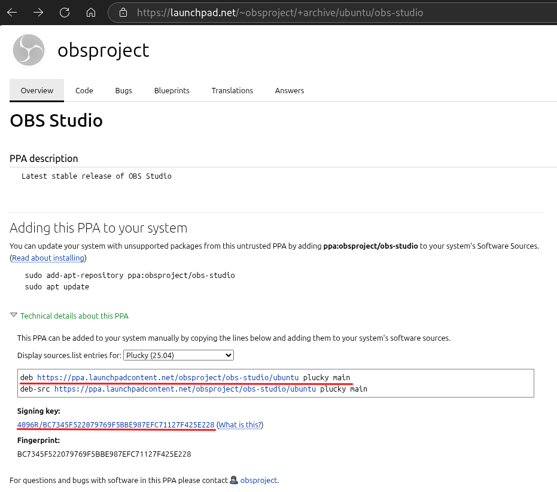
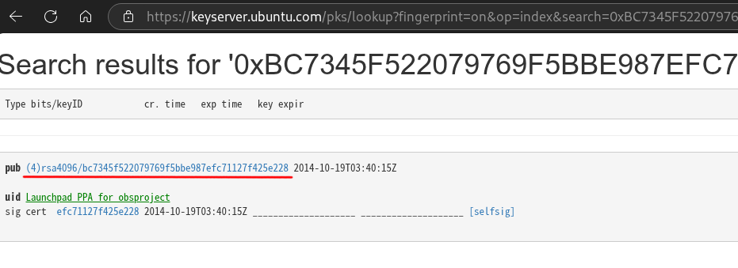

# Debian各软件源介绍
在Debian上可以使用许多软件源，下面将对一些常用的非特定软件的源进行介绍。
<!-- 添加关于ELTS的说明？ -->

## 常规源

常规源即系统所使用的常规软件源，其套件名（Suites）为Debian版本的代号或版本别名，其包含的组件（Components）为main、contrib、non-free、non-free-firmware。  

deb-822格式的常规源配置示例如下：  
```
Types: deb
URIs: https://deb.debian.org/debian/
Suites: trixie
Components: main contrib non-free-firmware non-free
```
<!-- signed-by: 相关内容呢？ -->
注：如果为Types添加值`deb-src`则可以通过`apt source <packages>`命令从仓库下载相应包源码。  

### 套件名 Suites
即Debian版本代号（如：trixie, bookworm, sid）或是版本别名unstable、testing、stable、oldstable、oldoldstable。如果使用版本别名则在版本别名实际对应系统变更后将会导致更新时系统升级为新版本。如当前stable对应的是trixie，在未来forky正式版放出后升级系统将导致系统升级为forky。  

代号说明：  
- unstable: 这个别名指向一个激进的开发版，其版本代号为`sid`。sid是一个一直处于开发状态的不稳定测试版，即其为一个滚动开发版。请务必注意，sid为滚动**开发版**，而不是Arch Linux那种滚动稳定版。
- testing: 这个别名指向当前开发中的下一个稳定版，当前其指向forky。在sid中经过完整构建和一段时间的稳定性测试、错误测试和兼容性测试的软件包将会合并到testing中。
- stable: 此别名指向当前最新的稳定版，当前其指向trixie。
- oldstable: 此别名指向上一代稳定版，当前其指向bookworm。
- oldoldstable: 通常此别名指向上上代稳定版，但如果上上代稳定版已结束LTS支持，则不指向任何版本（如空指针一样），<!-- 当前 -->曾经其指向bullseye。

### 组件 Components
源仓库的组成部分，用户可以选择使用哪些组件。  

各组件说明：  
- main: 包含了符合[DFSG](https://www.debian.org/social_contract#guidelines)并且依赖均符合DFSG的包，Debian中大部分包/主要的包均属于该组件。
- contrib: 包含了本身符合DFSG但存在非DFSG依赖的包。
- non-free: 包含重要的但不符合DFSG的包，这些包往往都是非自由的。
- non-free-firmware: 包含了不符合DFSG的固件<sup>注1</sup>包，大多数设备的运行依赖于这些包。  

注1: “固件”指控制电气设备的嵌入式软件，其往往被存放到设备的存储器上。以前，固件存放在设备的ROM或Flash中，但现在更常见的是在设备初始化时才将固件加载到设备的存储器中。  

## 安全源 Security

安全源负责为Debian提供及时的安全修复，其套件名通常为常规源的套件名加上后缀`-security`（假如常规源的套件名为`stable`，则相应安全源的套件名为`stable-security`），其包含的组件为main、contrib、non-free、non-free-firmware。  

注：sid没有对应安全源。  

Debian的次版本更新频率约为一到两个月一次，如果Debian系统中的软件被发现了安全漏洞，而等到下个Debian小版本更新才能获得修复的话。如果软件被发现了严重漏洞而不能及时获得安全修复的话，那使用这些软件的用户早就被渗成筛子了。而安全源则可以在在发现漏洞并编写好修复补丁后可以及时将修复完漏洞的软件版本及时推送给Debian用户。  

通常获得安全修复自然是越及时越好（特别是对于联网的生产环境来说）。因为安全源的镜像通常不会及时和官方安全源同步而是定时同步，所以为了及时获得安全修复，安全源应当直接使用Debian官方源（其URL为`https://security.debian.org/debian-security/`）。但如果因为当地网络问题或组织规定导致难以使用官方安全源的话，那也就只能使用镜像源了。  

deb-822格式的安全源配置示例如下：  
```
Types: deb
URIs: https://security.debian.org/debian-security/
Suites: trixie-security
Components: main contrib non-free-firmware non-free
```

## updates源
updates源用于提前获取小版本更新<sup>注1</sup>将会更新的包，其套件名为常规源的套件名加上`-updates`后缀，其包含的组件为main、contrib、non-free、non-free-firmware。  

注：sid没有相应的update源。  
注1：小版本更新在官方文档中被称作“点发布”（Point Releases），其为已有包提供bug修复和安全修复，但不会提供功能更新。  

deb-822格式的updates源配置示例如下：  
```
Types: deb
URIs: https://deb.debian.org/debian
Suites: trixie trixie-updates
Components: main contrib non-free-firmware non-free
Signed-By: /usr/share/keyrings/debian-archive-keyring.gpg
```
注：上面的配置文件中Signed-By的行是可选的，其用于指定了源的Release文件的密钥<!-- 有待进一步了解 -->，删除此行不影响该配置文件的功能。人们有时会在套件中既写常规源的套件名（如`trixie`）又写updates源的套件名（如`trixie-updates`），如此可以同时添加常规源和updates源。  

有一个名为Propased Upeates的特殊updates源，其包含提议在下一个点发布中添加的软件包（可以把它当作测试版的updates源）。其套件名为常规源的套件名加上`-propased-updates`。  

## Backports源
Backports（反向移植）源用于将Testing和Sid上的包移植<!-- 感觉“移植”一词不太准确，但我还没想到更准确的用词 -->到Stable上，以为Stable提供新版本的软件。该源的套件名为常规源的套件名加上`-backports`后缀，其包含的组件为main、contrib、non-free、non-free-firmware。  

注1：Backports源仅会移植一部分包。  
注2：Backports源不会提供一个稳定版的完整的5年生命周期，其提供将持续到对应稳定版的下一个稳定版发布后的一年内，即仅在相应稳定版的三年完整支持期间内提供此源。  

如果有使用Backports源的需要可见[Backports源的配置与使用](../improve/backports.md)。deb-822格式的Backport源配置示例如下：  
```
Types: deb
URIs: https://deb.debian.org/debian
Suites: trixie-backports
Components: main contrib non-free non-free-firmware
Signed-By: /usr/share/keyrings/debian-archive-keyring.gpg
```

除了常规的Backports源还存在一个特殊的Backports源——Backports Sloppy（瞎jb反向移植）源，该源将在新的Stable发布后为此时的Old Stable从Sid和Testing上将包反向移植。其套件名为常规源的套件名加上`-backports-sloppy`后缀。

要注意的是Backports Sloppy源未经过相应系统的兼容性和稳定性验证，并且使用该源将损害系统的可升级性。所以除非必要否则不宜使用此源。  

注：Backports Sloppy源亦仅在相应稳定版的三年完整支持期间内提供。  

## Deb Multimedia源
Deb Multimedia源是一个由Debian开发者[Christian Marillat](https://nm.debian.org/person/marillat/)和另一个DD维护的非官方Debian多媒体源。该源为Debian提供了更多多媒体程序与库，以及更新的多媒体软件和专有的或有特殊功能的软件与库。该源的官方URL为`https://www.deb-multimedia.org`，该源的套件名和常规源的套件名一样，其包含的组件为main、non-free。  

大部分时候Deb Multimedia的包和Debian兼容良好，但仍有小概率出现问题。如果有使用Deb Multimedia源的需要可见[Debian多媒体源](../improve/deb-mmedia.md)。deb-822格式的Deb Multimedia源配置示例如下：  
```
Types: deb
URIs: https://www.deb-multimedia.org
Suites: trixie
Components: main non-free
Signed-By: /usr/share/keyrings/deb-multimedia-keyring.pgp
```

## Ubuntu PPA
PPA全称为Personal Package Archive（个人包存档），PPA提供的包通常适用于Ubuntu及其衍生版，其用于提供比系统官方源更新的包或提供官方源所不包含的包。Ubuntu的PPA托管在[Launchpad](https://launchpad.net/)上。在Ubuntu及其衍生版中如果要使用某一软件的PPA源通常使用以下命令将PPA仓库添加到源列表中。  
```sh
add-apt-repository ppa:<ppa_repo>
apt update
apt install <packages>
```
但是PPA并不原生适用于Debian，Debian中甚至连添加PPA的工具add-apt-repository都没有，但这并不说明Debian就无法使用Ubuntu的PPA，下面将说明任何在Debian中使用Ubuntu PPA仓库（但可能存在兼容性问题或依赖缺失问题）。  

首先打开相应软件的PPA仓库的网页（如：`https://launchpad.net/~obsproject/+archive/ubuntu/obs-studio`）然后展开"Technical details about this PPA"折叠项，选择当前计算机Debian版本的正式发布年份的4月版Ubuntu（如：Trixie是2025年发布的，所以选择Ubuntu 25.04），之后在`/etc/apt/sources.list.d`中创建一个相应的list文件（如：obs-ppa.list）将deb那行复制下来并粘贴到该文件中，如：  
```
deb https://ppa.launchpadcontent.net/obsproject/obs-studio/ubuntu plucky main 
```
  
然后点击签名的链接再复制pub后面的链接。 
   
之后通过以下命令安装PPA仓库的密钥。  
```sh
wget <link> -O /etc/apt/trusted.gpg.d/<reponame>.asc
```
说明：`<link>`为刚刚复制的链接，`<reponame>`为相应的PPA仓库名（如：obs-studio）。  

然后修改前不久创建的list文件，在deb后多添加一个option：`[signed-by=/etc/apt/trusted.gpg.d/<reponame>.asc]`。
如上面的list示例在修改后内容如下：
```
deb [signed-by=/etc/apt/trusted.gpg.d/obs-studio.asc] https://ppa.launchpadcontent.net/obsproject/obs-studio/ubuntu plucky main 
```
最后保存文件，执行`apt update`更新软件列表后即可通过apt安装刚添加的PPA仓库中的软件。  

注：在Debian中使用PPA仓库时出现warning是正常情况。  

## Debusine
[Debusine](https://debusine.debian.net/)是Debian的官方PPA，目前该项目还处于Beta阶段，故目前不对其进行讨论，如想了解相关资料可见[Debusine
Debian-specific cloud-powered continuous integration platform](https://www.freexian.com/services/debusine/)和[Debusine: a CI platform for Debian-based distributions](https://freexian-team.pages.debian.net/debusine/)。  

## 试制源 Experimental
Experimental源实际上是一个特殊的Debian的测试版，其甚至不是一个独立的测试版，该源只能在Debian Sid中使用。Experimental源中包含着仍在开发中的包和工具该源中的包处于进入Debian的早期阶段（比sid还要早），使用Experimental中的包可能会导致严重的问题。  

正常用户不应该使用试制源，故本文不讨论其使用方法，如确实有相关需求请参考[DebianExperimental - Debian Wiki](https://wiki.debian.org/DebianExperimental)。  

## 参考资料
\[1\] [SourcesList - Debian Wiki](https://wiki.debian.org/SourcesList)  
\[2\] [DebianUnstable - Debian Wiki](https://wiki.debian.org/DebianUnstable)  
\[3\] [DebianTesting - Debian Wiki](https://wiki.debian.org/DebianTesting)  
\[4\] [Debian Social Contract](https://www.debian.org/social_contract#guidelines)  
\[5\] [Debian Free Software Guidelines - Wikipedia](https://en.wikipedia.org/wiki/The_Open_Source_Definition#Debian_Free_Software_Guidelines)  
\[6\] [Firmware - Debian Wiki](https://wiki.debian.org/Firmware)  
\[7\] [Debian Reference 2.1.5. Debian archive basics](https://www.debian.org/doc/manuals/debian-reference/ch02.en.html#_debian_archive_basics)  
\[8\] [DebianReleases/PointReleases - Debian Wiki](https://wiki.debian.org/DebianReleases/PointReleases)  
\[9\] [StableUpdates - Debian Wiki](https://wiki.debian.org/StableUpdates)  
\[10\] [StableProposedUpdates - Debian Wiki](https://wiki.debian.org/StableProposedUpdates)  
\[11\] [Securing Debian Manual 7.5. Package signing in Debian](https://www.debian.org/doc/manuals/securing-debian-manual/deb-pack-sign.en.html)  
\[12\] [Backports - Debian Wiki](https://wiki.debian.org/Backports)  
\[13\] [Debian Backports Instructions](https://backports.debian.org/Instructions/)  
\[14\] [Backporting - Wikipedia](https://en.wikipedia.org/wiki/Backporting)  
\[15\] [Index of /debian/dists](https://deb.debian.org/debian/dists/)  
\[16\] [Index of /debian-security/dists](https://security.debian.org/debian-security/dists/)  
\[17\] [Deb Multimedia Packages](https://deb-multimedia.org/)  
\[18\] [Deb Multimedia Packages::FAQ](https://deb-multimedia.org/faq)  
\[19\] [2.8. Well, isn't deb-multimedia.org an official part of Debian? - DebianMultimedia/FAQ - Debian Wiki](https://wiki.debian.org/DebianMultimedia/FAQ#Well.2C_isn.27t_deb-multimedia.org_an_official_part_of_Debian.3F)  
\[20\] [Christian Marillat - Debian New Member Process](https://nm.debian.org/person/marillat/)  
\[21\] [PPA - Ubuntu documention](https://help.ubuntu.com/community/PPA)  
\[22\] [The Ultimate Guide to PPA in Ubuntu](https://itsfoss.com/ppa-guide/)  
\[23\] [KXStudio : Repositories](https://kx.studio/Repositories)  
\[24\] [Debusine repositories now in beta](https://lists.debian.org/debian-devel-announce/2025/12/msg00003.html)  
\[25\] [Debusine](https://debusine.debian.net/)  
\[26\] [Debusine Debian-specific cloud-powered continuous integration platform](https://www.freexian.com/services/debusine/)  
\[27\] [Introduction to Debusine - Debusine  documentation](https://freexian-team.pages.debian.net/debusine/explanation/introduction.html)  
\[28\] [DebianExperimental - Debian Wiki](https://wiki.debian.org/DebianExperimental)  

---
Author: smgdream | License: CC BY-NC-SA 4.0 | Version: 0.7.1u | Date: 2026-09-04