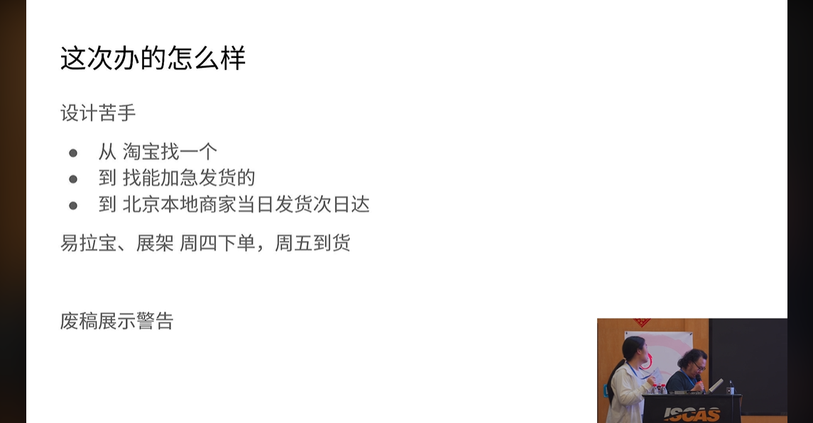
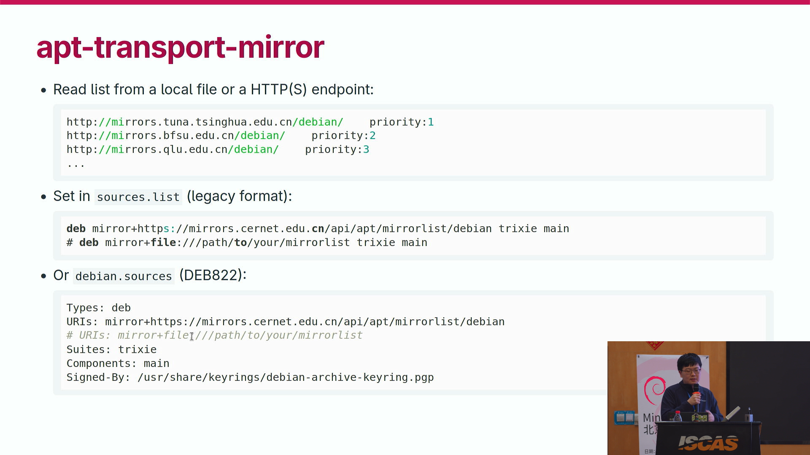
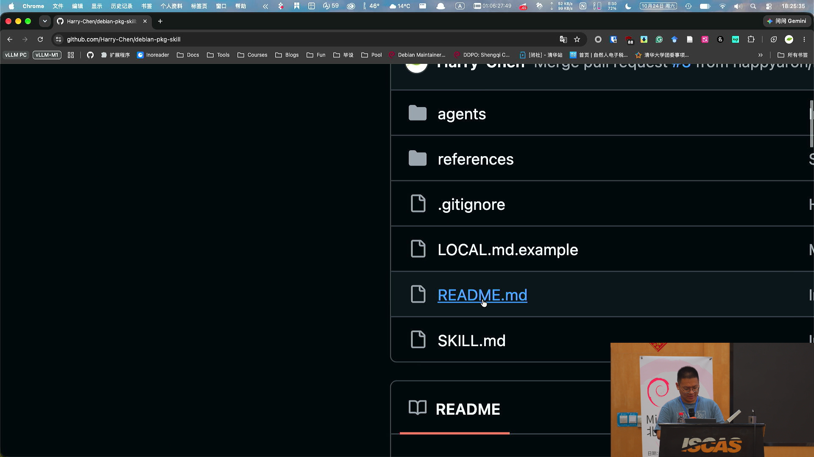
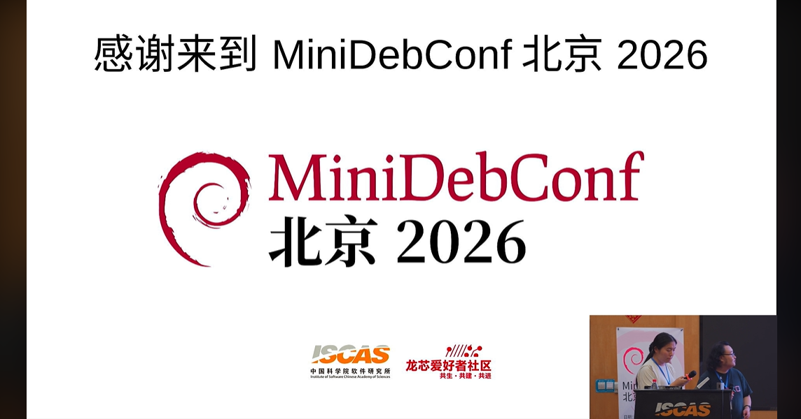
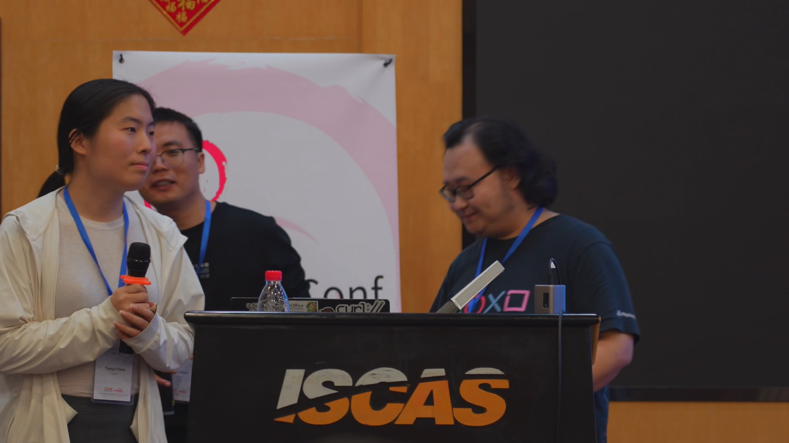
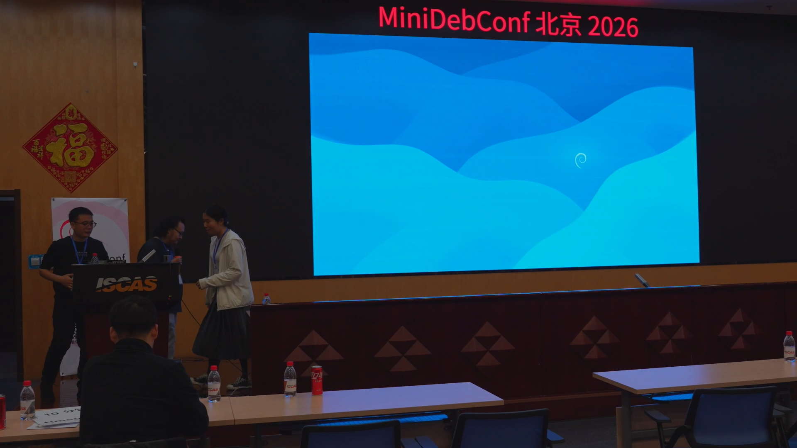

# 鱼板季报 26年秋
第1期 2026年11月6日 总编辑：smgdream

## eMudhra证书因私钥过于简单而被破解
2026年10月17日，印度证书颁发机构eMudhra签发的16张注1SSL中间证书被发现其私钥极为简单，P-384的密钥本应是一个384个二进制位的随机值，但eMudhra的私钥仅最低8位有实际值其他位均置为0。此问题已于10月21日公布，这16张证书的8个私钥均被破解并公之于众。此问题将导致任何人都可以使用该证书为任意域名签发伪造的有效SSL叶子证书，这将导致攻击者或中间人可以将自己的服务器伪造成对应域名的“合法”服务器，进而冒充目标网站执行一系列非法操作。

目前大多数仍在维护的电脑操作系统已提供相应热更新或安全更新以吊销相应证书，用户只需连接网络获取热更新或安装相应安全更新即可让操作系统吊销eMudhra证书。google Chrome和Firefox浏览器已及时通过热更新或新安全修复版本的方式吊销了相应证书。除此之外，许多软件使用的是其内置的独立证书，这些软件应尽快更新到最新版本或安全修复小版本注2。但对于手机系统，建议在手机安全设置中禁用相应的eMudhra证书和AAA证书，否则需要等待手机厂商推送相应的安全更新。

Microsoft Edge浏览器的情况则较为特殊，Edge浏览器使用其独立的内置证书，而截至目前，最新的Edge 157 Beta其仍未移除相应的内置证书。但Windows平台和Mac平台的Edge提供了证书验证服务，联网后将自动吊销相应的内置证书。但对于Linux平台的Edge，其尚未包含证书验证服务，需要[手动配置CADistrustedCertificates组织策略将相应证书添加到不信任列表中](https://forums.debiancn.org/t/topic/6928)。  

**特别提醒**，此事件所影响的证书的最久要到2040年4月末才过期，部分设备和软件可能在短期内不会获得更新，甚至永远不会获得更新，此事件的影响将会持续很久很久，请悉知。

注1：实际上是8份证书，对应8个私钥，但每份证书都有eMudhra自己签发的版本和Sectigo（原Comodo CA）交叉签发AAA版，所以共有16份证书。  
注2：部分受影响的软件及其修复后的版本的列表可见：https://emudhra.we-have-a-problem.com/#developers

smgdream报道

### 相关资料
[eMudhra Intermediate CA Compromise](https://emudhra.we-have-a-problem.com/)  
[印度eMudhra中间证书私钥存在严重缺陷：Chrome、Firefox迅速阻断，Go、Python、Rust均需更新](https://www.ithome.com/1/015/849.htm)  
[[原创]eMudhra-CA-利用-密码应用-看雪安全社区](https://bbs.kanxue.com/thread-293329.htm)  
[Changes to Microsoft Edge browser TLS server certificate verification](https://learn.microsoft.com/deployedge/microsoft-edge-security-cert-verification)  
<!-- [一文读懂 SSL 证书：从原理到网关部署全解析](https://zhuanlan.zhihu.com/p/717868894) -->

 

## Linux 7.3稳定版发布
2026年10月19日 Linux 7.3正式发布，此版本一些值得注意的更新为：改进任务调度，改进显存不足时的显存管理策略，改进Ext4和Btrfs文件系统的性能，NTFS3和NTFS文件系统驱动获得一些功能改进，初步支持M3 Pro、M3 Max、M3 Ultra Soc，添加对2026版Steam手柄的支持，AMD Zen6平台和Qualcomm Snapdragon x2系列的支持稳步推进中。除此之外Linux 7.3还有许多变更，相关资料中列出了参考资料。

### 相关资料
[Linux 7.3 changelog KernelNewbies](https://kernelnewbies.org/Linux_7.3)  
[ChangeLog-7.3](https://cdn.kernel.org/pub/linux/kernel/v7.x/ChangeLog-7.3)  
## MirrorZ教育网联合镜像站正式发布
2026年8月22日，教育网联合镜像站正式发布。[教育网联合镜像站（MirrorZ）](https://mirrors.cernet.edu.cn/)整合了国内多个高校和科研机构的开源镜像资源，提供了一个统一的镜像资源获取入口。

MirrorZ本身不存储软件资源，其提供的是一个智能302重定向服务，当用户通过MirrorZ使用镜像服务时，其请求将会被重定向到到一个合适的镜像站，如此一来既可提升用户的镜像服务使用体验，亦充分利用资源，平衡了高校的镜像服务压力。

[教育网联合镜像站正式发布](https://servers.ustclug.org/2026/08/mirrorz/)  
[MirrorZ讲稿](https://os.nju.edu.cn/media/2026/slides/01-MirrorZ%E6%95%99%E8%82%B2%E7%BD%91%E8%81%94%E5%90%88%E9%95%9C%E5%83%8F%E7%AB%99.pdf)  
[MirrorZ Help](https://help.mirrors.cernet.edu.cn/)  
[教育网联合镜像站今日正式发布](https://mp.weixin.qq.com/s/ipei4VrTTII0DgZqzMIzyw)  

## MiniDebConf Beijing 2026圆满结束
10月24日在北京中国科学院软件研究所举行的2026北京迷你Debian会议（MiniDebConf Beijing 2026）注1已圆满结束。  

<!-- 待添加会议内容 -->
截至本季报道条目冻结时会议主办方仍未上传会议录播，以下是此报道撰写者自己截取的部分会议直播快照：  

  
  
  
  
  
  

注1：这是久违21年的内地Debian会议，上一次还是2005年中国开源软件周在北京举办的“Debian小型会议”。

smgdream报道

### 相关资料

[MiniDebConf Beijing 2026](https://beijing2026.mini.debconf.org/)  
[Asia Debian Mini-Conf: CfP and Registrations Reminder](https://lists.debian.org/debian-devel-announce/2005/01/msg00008.html)  
[亞洲 Debian 小型會議 & CodeFest 報導](https://web-archive-2025.openfoundry.org/en/foss-news/201--debian-a-codefest-.html)  
<!--
[第一届开源软件周(2005)](https://web.archive.org/web/20050308130906/http://www.chinaossweek.org/hyyc.php?t_id=1)  
[2005年中国开源软件周即将隆重开幕](https://tech.sina.com.cn/it/2005-03-03/1341541207.shtml)  
-->

## Debian 13.7发布
2026年9月12号，Debian项目组发布了Debian 13.7。这是Debian 13的第七个小版本更新，其包含了Bug修复与安全修复。为了确保系统的安全强烈建议Debian 13的用户将系统更新到此版本或更新版本。

smgdream报道

### 相关资料
[Updated Debian 13: 13.7 released](https://www.debian.org/News/2026/20260912)  

## ~~机关S~~CERN开始~~渗透~~转投Debian
2026年9月1日，CERN（欧洲核子研究组织）在MiniDebConf Winterthur 2026（2026瑞士温特图尔迷你Debian会议）上宣布，在2026年末将其所拥有的2200多部工业计算机和嵌入式系统的操作系统全部更换成Debian 13。  

smgdream报道

### 相关资料
[...CERN will be running Debian 13](https://micronews.debian.org/2026/1788286274.html)  
[Controlling CERN's Accelerators with Debian](https://ch2026.mini.debconf.org/talks/6-controlling-cerns-accelerators-with-debian/)  
[Controlling CERN's Accelerators with Debian (Video)](https://meetings-archive.debian.net/pub/debian-meetings/2026/MiniDebConf-Winterthur/ch2026-53-controlling-cerns-accelerators-with-debian.av1.webm)  

## Debian 11 LTS已结束支持
2026年8月31日
Debian 11已于2026年8月31日结束长期支持，至此Debian 11的官方支持已结束，其到达了其生命的终点（EOL）。

对于目前仍在使用Debian 11的用户，建议将系统升级到当前仍提供支持的版本。如果因为某些缘由无法升级系统则可以订购Freexian公司提供的ELTS服务，ELTS服务可将系统的生命周期延长至10年。 

smgdream报道

### 相关资料
[Debian 11 Long Term Support reaches end-of-life](https://www.debian.org/News/2026/20260831)  
[Freexian](https://www.freexian.com/)  
[Freexian announces Extended LTS for Debian 11](https://www.freexian.com/blog/extended-lts-for-debian-11/)  

## 在Debian开发中使用LLM的投票
2026年8月30日关于在Debian的开发中使用LLM相关提议的投票结果出炉了。在本次投票中一共由八个提议，在经过社区人员的孔多塞投票（Condorcet method for voting）后，提议5从中胜出。提议5的核心观点为：“负责任地使用生成式AI”（Responsible Use of Generative AI）。此后，在Debian的开发中可以<!--在此严谨地选用了“可以”一词，Debian neither endorses nor prohibits the use of generative AI tools ... -->使用生成式AI但其自然人贡献者需要对其负责。  

提议5的文本另见附录A。  

注：标题及文中“开发”一词指的是广义的开发。  

smgdream报道

### 相关资料
[General Resolution: LLM usage in Debian](https://www.debian.org/vote/2026/vote_002)  
[Debian 社区议案表决：开发者可使用生成式 AI，人类负最终责任](https://www.ithome.com/0/996/035.htm)  

## Linux 7.2稳定版发布
2026年8月16日Linux 7.2发布，此版本一些值得注意的更新为：改进了GPU调度、初步支持Apple M3设备、初步支持AMD GPU的HDMI 2.1 FRL功能、改进对BTRFS, NTFS, XFS, EXT4等文件系统的功能、改进内存管理相关的功能。除此之外还包含了许多功能改进，新增了对许多新设备的支持，以及修复了许多安全漏洞。

若想了解Linux 7.2更新内容可参见“相关资料”段落给出的参考资料。

smgdream报道

### 相关资料
[Linux 7.2](https://lore.kernel.org/lkml/CAHk-=wjk5StpAmUKHacj=GPKwA88y_YRHK=i_YAJFgmxn1=k4w@mail.gmail.com/)  
[Linux_7.2 - Linux Kernel Newbies](https://kernelnewbies.org/Linux_7.2)  
[Linux 7.2 Features: Cache Aware Scheduling, USB4STREAM, AMD ISP4, AMDGPU HDMI 2.1 FRL](https://www.phoronix.com/review/linux-72-features)  

## Debian 13.6发布
2026年7月11日，Debian项目组发布了Debian 13.6。该版本包含了大量的安全修复，包括Linux内核的许多重要漏洞修复，建议各位Debian用户将系统更新至此版本或更新版本。

另外，对于支持UEFI启动的计算机，如果安全启动证书尚未更新到2025版，建议在更新完系统后通过更新安全启动证书。以确保以后可以继续使用安全启动功能。  

smgdream报道

### 相关资料
[Updated Debian 13: 13.6 released](https://www.debian.org/News/2026/20260711)  
[SecureBoot/CAChanges - Debian Wiki](https://wiki.debian.org/SecureBoot/CAChanges#What_should_I_do.3F)  
[更新固件 UEFI安全启动证书更新](fwupd.md)  

## Debian 12.15发布
Debian项目组于2026年7月11日发布了Debian 12.15。该版本包含了大量的安全修复，包括Linux内核的许多重要漏洞修复，建议各位Debian用户将系统更新至此版本或更新版本。在此版本之后Debian 12将进入LTS阶段，如果条件允许建议将系统更新至Debian 13。

另外，对于支持UEFI启动的计算机，如果安全启动证书尚未更新到2025版，建议在更新完系统后通过更新安全启动证书。以确保以后可以继续使用安全启动功能。  

smgdream报道

### 相关资料
[Updated Debian 12: 12.15 released](https://www.debian.org/News/2026/2026071102)  
[SecureBoot/CAChanges - Debian Wiki](https://wiki.debian.org/SecureBoot/CAChanges#What_should_I_do.3F)  
[更新固件 - UEFI安全启动证书更新](fwupd.md)  

## 旧闻速报
- [Debusine仓库现已进入公测阶段](https://lists.debian.org/debian-devel-announce/2025/12/msg00003.html)  
- [loongarch 64已成为Debian官方架构](https://lists.debian.org/debian-devel-announce/2025/12/msg00004.html)  

## 附录A
**Proposal E**  
**Choice 5: Responsible Use of Generative AI**  

Using its power under Constitution section 4.1 (5), the project issues the following statement describing its current position on AI-assisted contributions. This statement describes the position of the project at the time it is adopted. That position may evolve as time passes without the need to resort to future general resolutions. The GR process remains available if the project needs a decision and cannot come to a consensus.

Debian neither endorses nor prohibits the use of generative AI tools in the development, maintenance, or documentation of software, packaging, documentation, and other media published within the Debian Project. We recognize that such tools can substantially improve the productivity of contributors when used responsibly, allowing volunteers to spend more of their limited time on work that requires technical expertise, judgment, review, and collaboration.

The Debian Project nevertheless expects that all contributions submitted to Debian, regardless of how and with which tools they were produced, satisfy the same standards of quality, correctness, maintainability, and legal compliance. The use of a generative AI tool does not diminish the contributor's responsibility for the work they submit. Contributors are expected to understand, review, test, and, where appropriate, modify AI-assisted output before incorporating it into Debian. Blindly accepting or uploading AI-generated material without appropriate human review is inconsistent with Debian's established development practices. We enourage our contributors to disclose whether a contribution was made with AI assitance, but do not require them to do so.

Debian acknowledges that the legal status of material produced by generative AI systems remains the subject of ongoing discussion in many jurisdictions, including questions relating to copyright, authorship, licensing, and potential reproduction of training material. The Project does not seek to resolve these unsettled legal questions through this General Resolution, nor does it adopt a position on whether AI-generated output is, in whole or in part, copyrightable or derived from copyrighted works.

Instead, Debian continues to rely on the judgment and responsibility of its individual contributors. Project members are expected to exercise appropriate care when using generative AI tools, to consider the provenance and licensing implications of material they contribute, and to avoid introducing content whose legal status they cannot reasonably justify. Existing Debian policies governing licensing, copyright, software freedom, and the acceptance of contributions continue to apply irrespective of the tools used to produce those contributions.

Contributors are expected to exercise appropriate care when designing and implementing workflows that incorporate generative AI tools. In particular, they should ensure that confidential information, private communications, security-sensitive information (such as embargoed information about security bugs that is not yet public), cryptographic keys, credentials, and other non-public material relating to the Debian Project, its infrastructure, or its community are not disclosed to third-party AI services unless such disclosure has been explicitly authorized and is consistent with Debian's security and privacy requirements.

The use of generative AI does not alter Debian's established expectations regarding large-scale or automated project actions. Contributors intending to perform actions with broad project impact, such as mass bug filing or patch submission, large-scale code modifications, or other automated changes or requests affecting many packages or contributors, should seek prior discussion and consensus through the appropriate project channels before proceeding. Any such automated process should be overseen by a human who remains accountable for its behavior and output.

This resolution therefore affirms that generative AI is neither exempt from nor subject to special rules beyond the standards already expected of Debian contributors. The responsibility for every contribution rests with the contributor who submits it, who remains accountable for its technical quality, legal acceptability, and suitability for inclusion in Debian.

Copyright © 2026 SPI and others;

---
License: CC0 1.0 | Date: 2026-11-06