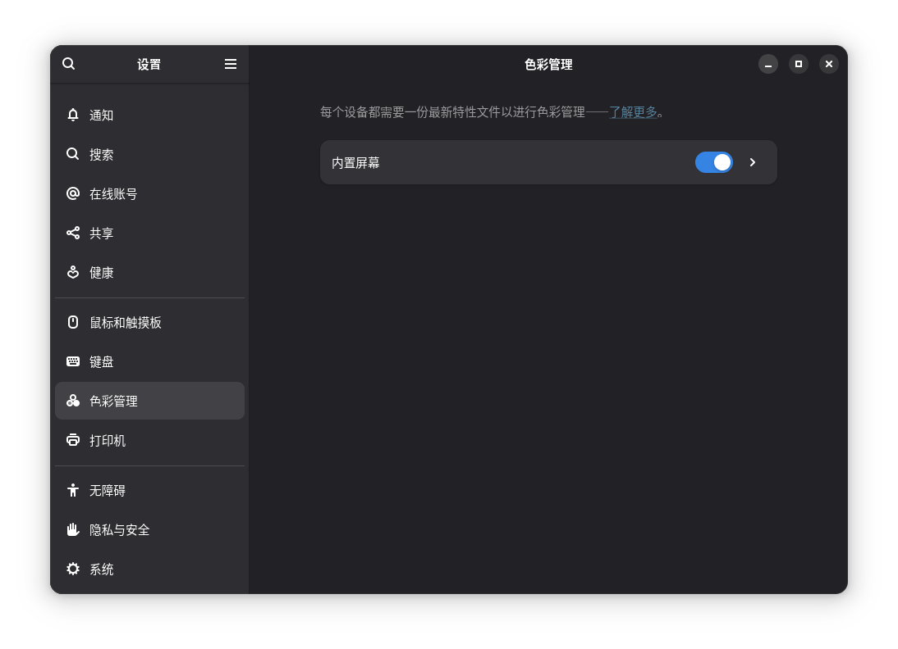
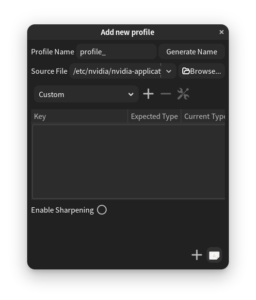

# Debian Trixie Bug报告

## 1. 部分环境中GTK4应用汉字渲染异常
问题描述：在100%显示缩放1.00字体缩放的前提下，gtk4应用中部分控件中部分汉字存在渲染异常的情况（如“色”字底下被截去，“最”字顶上被截去）。  
  
问题定位：经过本人、朋友及网友的努力，现已基本确定该bug来源于上游gtk4。（定位过程：[Some apps in Deb13 render Chinese characters abnormally](https://forums.debian.net/viewtopic.php?t=162883)、[debian trixie部分中文渲染异常bug报告](https://forums.debiancn.org/t/topic/5744)）  
修复状态：未修复  

## 2. 较差的NTFS文件系统支持
问题描述：Debian trixie的NTFS文件驱动由ntfs-3g更换为了ntfs3，当NTFS分区存在脏分区问题时ntfs3将拒绝挂载相应分区。  
问题定位：问题来自于ntfs3驱动对NTFS文件系统支持不够完善。  
缓兵之计：使用Windows或Windows PE的磁盘检查工具扫描并修复磁盘。  
修复状态：未处理  

吐槽：我估计该问题若想要解决估计要等到Microsoft什么时候心情大好把NTFS文件系统规范开源了才行（我估计在ReFS成为Windows的默认文件系统后才有可能）~~或者被来自霓虹的神秘黑客Barrel Titor攻破机构的服务器将机构的秘密公之于众后才行~~。  

## 3. 应用文件夹偶尔无法正常关闭
问题描述：偶尔会遇到gnome应用文件夹无法通过点击应用文件夹外的空白区域关闭（除了dock栏和顶栏）。  
问题定位：在Manjaro中也存在相似情况，故推测该bug源自于上游。  
修复状态：已修复

## 4. 部分应用内少数图标缺失
问题描述：部分应用内的图标依赖于系统中安装的图标，而应用里的部分图标在系统图标库中没有对应图标，导致显示"image-missing"图标。  
  
修复状态：未修复

## 5. 部分图形界面程序关闭时会稍微卡顿
问题描述：部分图形界面程序有时关闭时会稍微卡顿，如: Ptyxis和NVIDIA X Server Settings。  
修复状态：未修复  

## 6. Nautilus文件重命名的小问题
问题描述：Nautilus在重命名文件名长度超过70字符的文件时，光标可能无法反向选中所有字符（正向选择则不存在此问题）。  
修复状态：未修复  

## 7. Nautilus无响应问题
问题描述：Nautilus在极个别时候Nautilus会陷入无响应状态，此时对Nautilus的任何操作都没有响应。  
缓兵之计：关掉Nautilus再重新打开。  
修复状态：未修复

## 8. 在GNOME系统状态菜单连接WIFI无法输入密码
问题描述：在GNOME系统状态菜单连接WIFI不会弹出WIFI密码输入窗口。于是无法连接需要密码的WIFI。  
缓兵之计：在“设置”应用中先进入WIFI设置菜单，再点击要连接的WIFI条目，然后点击条目右侧的齿轮（WIFI设置）图标，再进入“安全”选项卡，之后输入WIFI密码并应用。才可以连接设置了密码的WIFI。  
修复状态：未修复  

## 9. GNOME图形界面突然变得卡顿
问题描述：在个别时候GNOME桌面环境中图形界面突然变得卡顿，最明显的表现为移动鼠标时无法丝滑移动，走走停停。  
缓兵之计：重启计算机。
修复状态：未修复

## 10. 大写锁定指示灯状态错误
问题描述：在使用图形界面的特定情形中小概率会出现大写指示灯于实际大写锁定状态不一致的问题。
缓兵之计：<!-- gnome tweak修复法，或 -->重启计算机或把指示灯用胶布盖住（掩耳盗铃）。
修复状态：未修复

---
License: CC0 1.0 | Version: 0.7.5 | Date: 2026-08-24
