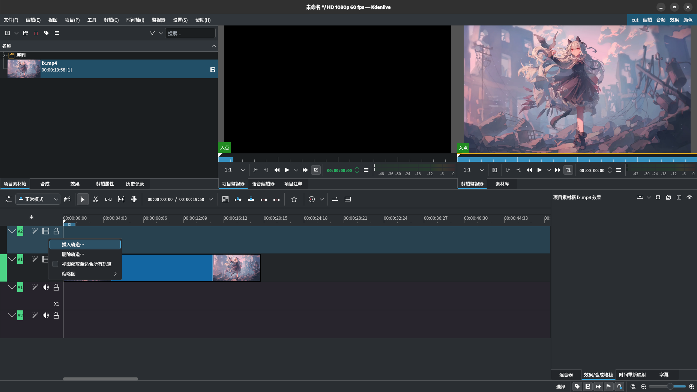
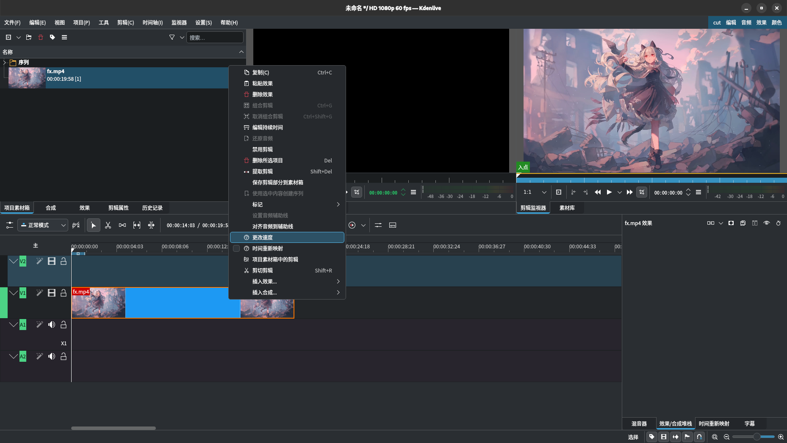
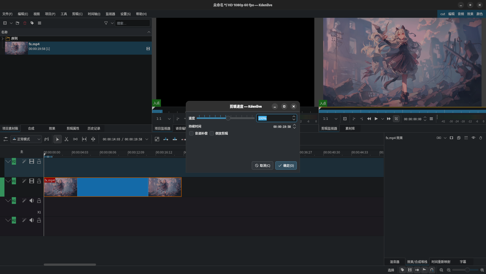
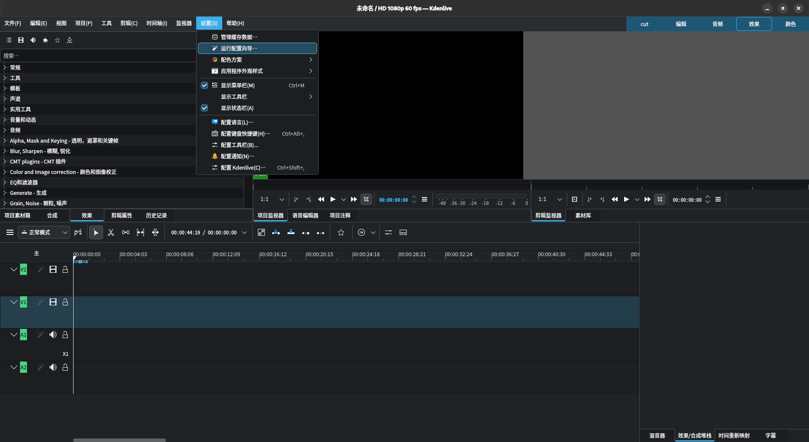
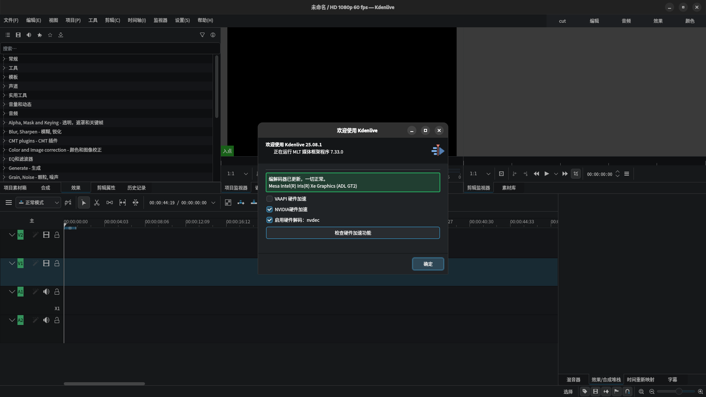
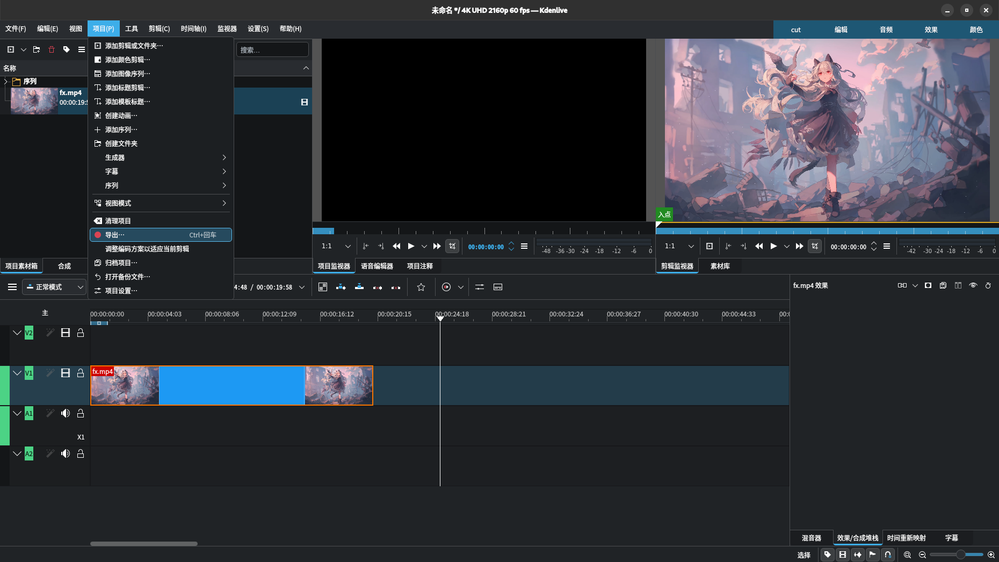
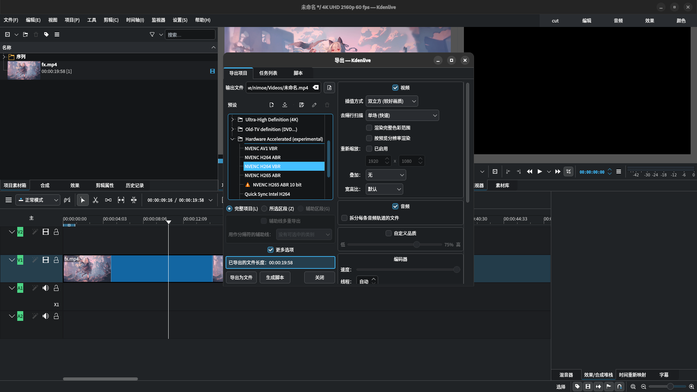
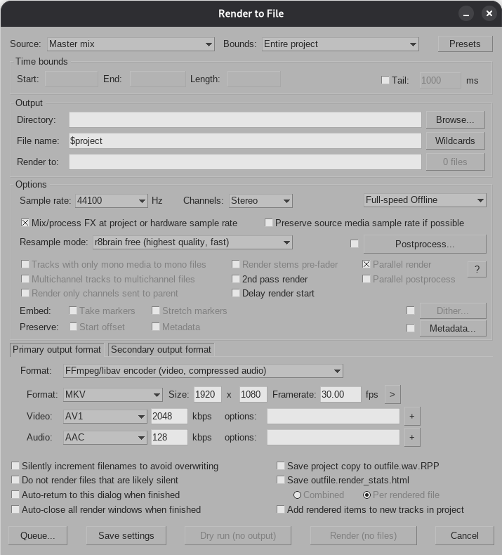
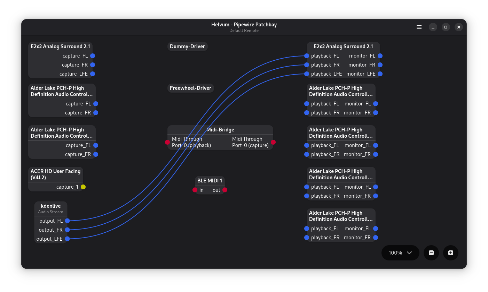

# 其他软件使用说明

## Kdenlive
Kdenlive是一个开源的功能较为完善的非线性视频编辑软件。其UI界面使用了QT框架。  

### 注意事项

对于Kdenlive 25.12及更新版本默认在启动时会显示项目的导览（欢迎）界面，在该界面中可设置剪辑项目的格式。如果没有显示该界面请检查 *设置->配置Kdenlive->系统环境->启动时显示欢迎屏幕* 选项是否已勾选。  

而Kdenlive 25.12之前的版本没有项目导览界面，在开始对项目的操作之前务必确保已将项目参数设置为所需的参数。可在 *项目->项目设置* 中更改当前项目的参数，亦可在 *设置->配置Kdenlive->项目默认值* 菜单中设置默认项目参数。  

### 新建轨道
右键任意轨道的轨道头即可新建相应类型（视频/音频）的新轨道。  
  

### 加速单个剪辑
右键剪辑片段点击 *更改速度* 即可调整相应剪辑片段的速度,也可以按住`Ctrl`并拖动剪辑片段边缘来更改速度。  
  
  

### 硬件渲染导出
<!-- 图示待更新 25.12 -->  
在第一次使用Kdenlive前点击 *设置->运行配置向导* ，然后点击 *检查硬件加速功能* 再点击 *确定* 即可完成硬件加速功能的配置。  
  
  

在渲染导出影片时，点击 *文件->导出*（对于25.12之前的版本为 *项目->导出* ），然后选择Hardware Accelerated (experimental)预设组中当前硬件所支持的编码预设即可通过硬件渲染导出影片。  
  
  

## REAPER
<!-- todo IME支持 -->
<!-- todo 非拉丁语言显示 -->
### 隐藏空白TCP区域的插入轨道按钮

隐藏从7.46开始出现的空白TCP区域显示的插入轨道按钮的方法：  

右键插入轨道按钮->Customize toolbar->移除Customized toolbar中的Insert track->OK。  

### 导入导出视频
<!-- 待微调行文 -->
如果REAPER无法导入导出除avi、mov以外格式的视频需另外安装FFmpeg。  

对于REAPER 7.66及更新版本，其支持FFmpeg 5.0-8.1版本。故只要通过包管理器安装了符合要求的FFmepg即可使用视频的导入导出功能。如果不想使用包管理器安装的版本或想使用比源仓库中更新的版本可在[BtbN](https://github.com/BtbN/FFmpeg-Builds/releases)上下载适用于Linux的FFmpeg GPL版<!-- 静态 -->share构建，然后将压缩包的lib目录中的`lib*.so.*`复制到REAPER程序目录的Plugins目录。 

注：BtbN会删除其过旧的FFmpeg构建，如有需要请妥善保存构建。<!-- FFmpeg 4.4的构建就这么被删了，我也没有专门保存(我#$%&*^...口吐芬芳) -->  

而对于REAPER 7.65及之前版本则要求FFmpeg的版本必须为4.x。而如今常见的网站上已不再提供FFmpeg 4.x的构建。需要花费些精力搜寻或通过源码编安装。  

REAPER 7.66及更新版本在安装了新版本的FFmepg后可以通过FFmpeg导出H.264, H.265, AV1等多种编码格式的视频，若机器硬件支持还可以通过硬件编码加速导出。  

  

渲染时将输出格式设为FFmpeg/libav即可使用FFmpeg渲染导出，随后可根据需要选择合适的视频容器格式、音视频编码格式。如果需要使用硬件编码则要在视频的options处添加合适的硬件编码参数，如：`-c:v hevc_nvenc`。  

<!-- todo更全面的黑暗模式 -->

## Helvum
Helvum是由pipewire团队开发的pipewire音频路由设置工具。  
  

### 建立音频连接
从应用的输出端点拉出一根线并拉到音频设备的输入端点即可建立音频连接。  

### 断开音频连接
在已有线路的一端拉到另一端即可断开当前线路的音频连接。  

## DeaDBeeF

### 通过ALSA输出播放mp3音频
使用ALSA输出方式可能无法播放mp3文件，问题的解决方式如下：  

在 *偏好设置->采样精度中* 指定采样精度，对于板载声卡及中低端专业声卡通常设置为24bit，对于部分HIFI声卡及高端专业声卡根据声卡本身采样率支持情况可以将采样率设置为32bit。  

### 调整布局
勾选 *查看->设计模式* ，然后即可右键用户界面更改控件或调整布局。  

### 安装插件
将插件的共享库文件复制到DeaDBeeF安装目录下的`lib/deadbeef`目录中即完成插件的安装。  

## 参考资料
\[1\] [Adding Tracks — Timeline — Kdenlive Manual 25.04 documentation](https://docs.kdenlive.org/en/user_interface/timeline.html#adding-tracks)  
\[2\] [Change Speed of a Clip — Editing — Kdenlive Manual 25.04 documentation](https://docs.kdenlive.org/en/cutting_and_assembling/editing.html#change-speed-of-a-clip)  
\[3\] [Change speed — Right-Click Menus — Kdenlive Manual 25.04 documentation](https://docs.kdenlive.org/en/cutting_and_assembling/right_click_menu.html#change-speed)  
\[4\] [ddb_waveform_seekbar/README.md at master · cboxdoerfer/ddb_waveform_seekbar](https://github.com/cboxdoerfer/ddb_waveform_seekbar/blob/master/README.md)  
\[5\] [REAPER | Old Versions](https://www.reaper.fm/download-old.php?ver=7x)  
\[6\] [SOLVED: Reaper cannot find ffmpeg on a clean Ubuntu 22.10 install](https://forum.cockos.com/showthread.php?t=273801&page=2)  

---
Author: smgdream | License: CC BY-NC-SA 4.0 | Version: 0.6.6u | Date: 2026-09-29
